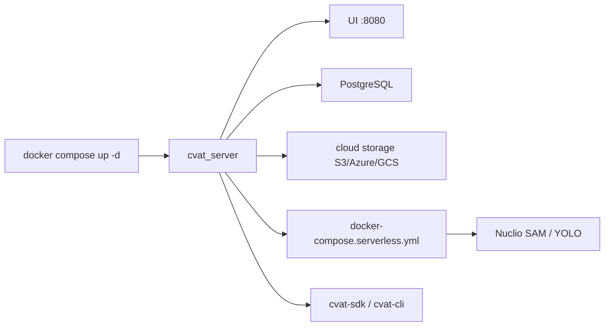

# cvat-ai/cvat

> Self-hosted vision annotation tool: images, videos, 3D point clouds.

## The problem
Annotating a detection or segmentation dataset with several people requires a tool that
handles roles, review, quality and twenty export formats — otherwise it is CSVs
and Excel.

## What it actually does
Boxes, polygons, masks, keypoints, cuboids, tags. Organized as projects →
tasks → jobs, assignment, progress tracking, comments and issues. Quality
control through consensus, Ground Truth and Honeypot via the server API. Export/import
in 20+ formats (COCO, YOLO, Ultralytics, Pascal VOC, KITTI, MOT…), S3 /
Azure / GCS connection. Automatic pre-annotation through Nuclio serverless models (SAM, YOLOv7,
RetinaNet, HRNet, TransT…). Python SDK `cvat-sdk` and CLI `cvat-cli`.

## How it is wired


## Trying it
```bash
git clone https://github.com/cvat-ai/cvat
cd cvat
docker compose up -d
docker exec -it cvat_server bash -ic 'python3 ~/manage.py createsuperuser'
pip install cvat-sdk
```

## Cost and gotchas
The Community edition is MIT and free, but SAM 2/SAM 3 auto-labeling, AI
agents, SSO, the quality control UI and advanced analytics are
reserved for the paid CVAT Online or Enterprise plans. Automatic annotation
in Community requires deploying Nuclio and `nuctl` on top. Tested mostly on Chromium;
Safari/WebKit is not supported.

## What it is not
It is not a text or tabular labeling tool. The free version is
not the version demoed on the website: the Community/Online boundary is sharp and
must be checked before promising a feature.

## Alternatives
- CVAT Online: the same product as SaaS, to avoid the deployment.
- Labeling Services: outsource the annotation rather than do it yourself.

## For you
The de facto standard for self-hosted vision annotation; worth remembering as soon as a
CV project needs a real annotation workshop.
