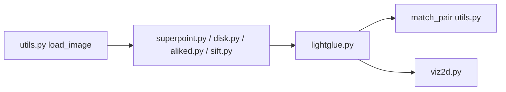

# cvg/LightGlue

> Neural network that matches local keypoints between two images, for 3D vision and localization.

## The problem
Quickly matching points between images (3D reconstruction, visual localization) with a cost that varies with the difficulty of the pair.

## What it actually does
Takes the keypoints and descriptors of two images and returns the indices of the matches. Depth (layers) and width (points) adapt to each pair thanks to early stopping and pruning. Weights are provided for SuperPoint, DISK, ALIKED and SIFT. The repo contains inference; training is done with glue-factory. Also available in Hugging Face Transformers.

## How it is wired


## Trying it
```bash
git clone https://github.com/cvg/LightGlue.git && cd LightGlue
python -m pip install -e .
python benchmark.py [--device cuda] [--add_superglue] [--num_keypoints 512 1024 2048 4096] [--compile]
```
The README also provides a Python matching script (extractor + matcher).

## Cost and gotchas
Free. The examples use `.cuda()`; CPU is possible but slower (20 FPS at 512 keypoints according to the README). The pruning thresholds are tuned for RTX 30xx GPUs.

## What it is not
Not a full reconstruction pipeline: it only matches keypoints that have already been extracted. The speed figures come from the authors.

## Alternatives
- SuperGlue: the predecessor compared in the benchmark.

## For you
Worth watching: a solid building block if you do 3D vision, off-topic for text or tabular data; last push in February 2026.
