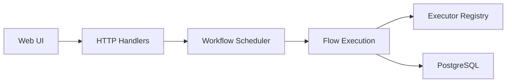

# cvhariharan/flowctl

> Self-service workflow platform with SSO, approvals and remote execution, in a single binary.

## The problem
Give access to sensitive operations (SSH access, infrastructure creation, business processes) without handing out keys or going through a ticket every time.

## What it actually does
You describe a workflow in YAML or HUML with inputs, actions and approvals. Executors run Docker containers, scripts, remote SSH commands or plugins. The server handles OIDC authentication, teams with RBAC, encrypted secrets, live logs, cron scheduling and signed webhook notifications.

## How it is wired


## Trying it
```bash
./flowctl --new-config
./flowctl install
./flowctl start
# puis http://localhost:7000
```

## Cost and gotchas
It requires PostgreSQL and Docker. SSO authentication assumes an OIDC provider. Part of the handler wiring is inferred from the directory tree, based on the architecture description.

## What it is not
Not a data pipeline orchestrator in the Airflow sense: it is a self-service portal with approvals. Not a lightweight tool without a database.

## Alternatives
No alternative named in the README.

## For you
Worth watching: useful for exposing MLOps operations to teams with approvals, but little proven (October 2025 repo, a single author).
