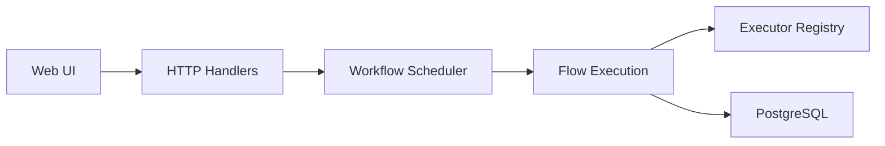

# cvhariharan/flowctl

> Plateforme de workflows en libre-service, avec SSO, validations et exécution à distance, en un seul binaire.

## Le problème
Donner accès à des opérations sensibles (accès SSH, création d'infrastructure, processus métier) sans livrer les clés ni passer par un ticket à chaque fois.

## Ce que ça fait vraiment
On décrit un workflow en YAML ou HUML avec des entrées, des actions et des validations. Les exécuteurs lancent des conteneurs Docker, des scripts, des commandes SSH distantes ou des plugins. Le serveur gère l'authentification OIDC, les équipes avec RBAC, les secrets chiffrés, les journaux en direct, la planification cron et des notifications par webhook signé.

## Comment c'est branché


## Essayer
```bash
./flowctl --new-config
./flowctl install
./flowctl start
# puis http://localhost:7000
```

## Coût et pièges
Il faut PostgreSQL et Docker. L'authentification SSO suppose un fournisseur OIDC. Une partie du câblage des handlers est déduite de l'arborescence, d'après la description d'architecture.

## Ce que ce n'est pas
Pas un orchestrateur de pipelines de données au sens d'Airflow : c'est un portail de libre-service avec validations. Pas un outil léger sans base de données.

## Alternatives
Aucune alternative nommée dans le README.

## Pour toi
À surveiller : utile pour exposer des opérations MLOps à des équipes avec validation, mais peu éprouvé (dépôt d'octobre 2025, un seul auteur).

