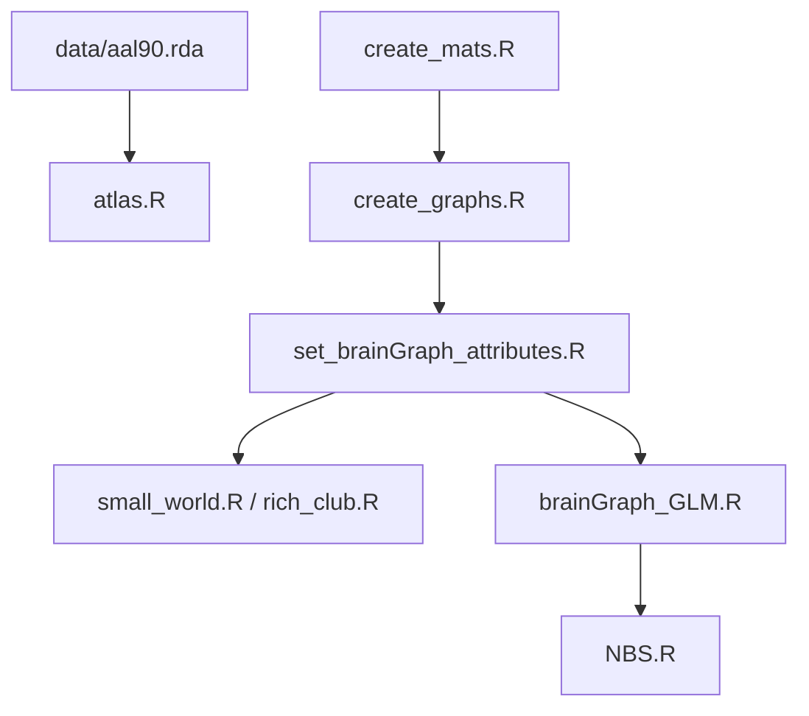

# cwatson/brainGraph

> R package for graph analysis of brain MRI: structural covariance, tractography, fMRI.

## The problem
Analyzing brain connectivity requires linking atlases, matrices and network statistics.

## What it actually does
Builds igraph graphs from connectivity matrices and atlases (dk, aal, hcp_mmp1.0, etc.), computes small-world, rich club and efficiency measures, and offers GLM, NBS, MTPC, mediation, and a graphical plotting interface.

## How it is wired


## Trying it
```bash
# R : install.packages('brainGraph')
# R : devtools::install_github('cwatson/brainGraph')
```

## Cost and gotchas
Free. Requires R; multi-core via doMC or doSNOW; Freesurfer or FSL upstream. Last push in February 2024; license not declared.

## What it is not
Not an MRI image-processing tool: it starts from connectivity matrices that have already been computed.

## Alternatives
No alternative named in the README.

## For you
Worth watching: only for neuroimaging in R; otherwise outside your stack.
