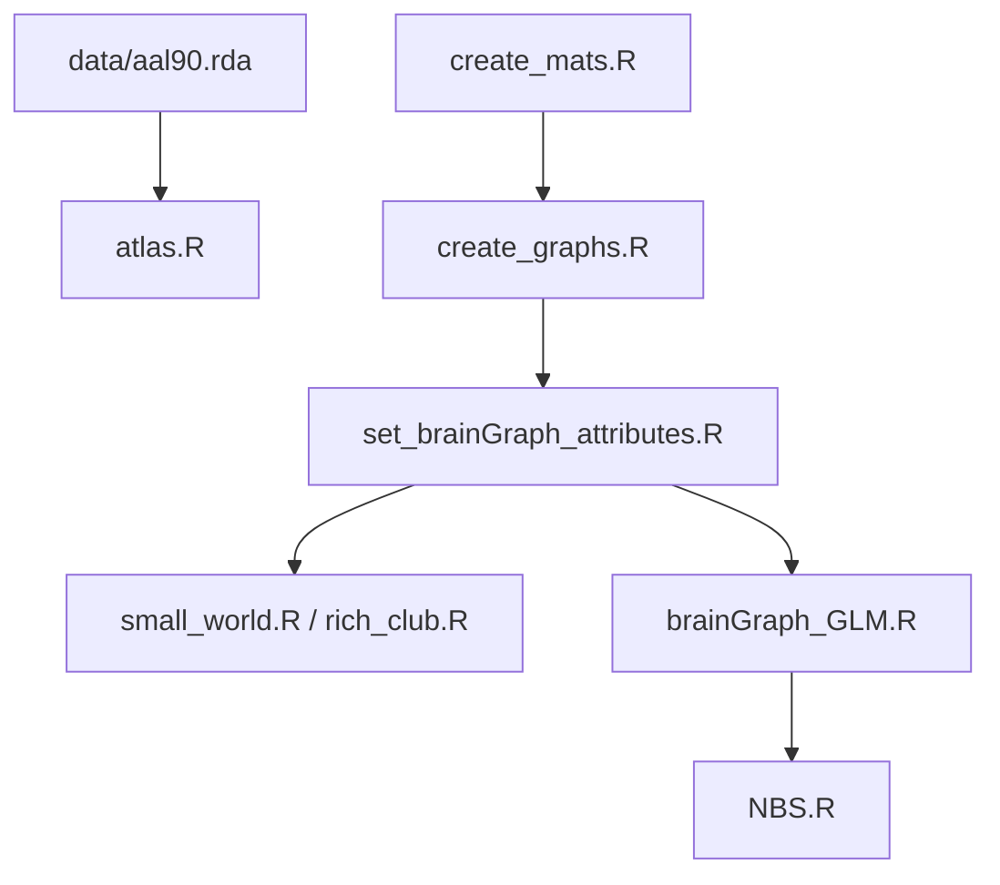

# cwatson/brainGraph

> Paquet R d'analyse de graphes sur des IRM cérébrales : covariance structurelle, tractographie, IRMf.

## Le problème
Analyser la connectivité cérébrale demande de relier atlas, matrices et statistiques de réseaux.

## Ce que ça fait vraiment
Construit des graphes igraph depuis matrices de connectivité et atlas (dk, aal, hcp_mmp1.0, etc.), calcule petit monde, rich club, efficacité, et propose GLM, NBS, MTPC, médiation, et une interface graphique de tracé.

## Comment c'est branché


## Essayer
```bash
# R : install.packages('brainGraph')
# R : devtools::install_github('cwatson/brainGraph')
```

## Coût et pièges
Gratuit. R requis ; multi-cœurs via doMC ou doSNOW ; Freesurfer ou FSL en amont. Dernier push en février 2024 ; licence non déclarée.

## Ce que ce n'est pas
Pas un outil de traitement d'images IRM : il part de matrices de connectivité déjà calculées.

## Alternatives
Aucune alternative nommée dans le README.

## Pour toi
À surveiller : seulement en neuro-imagerie sous R ; sinon hors de ta pile.

