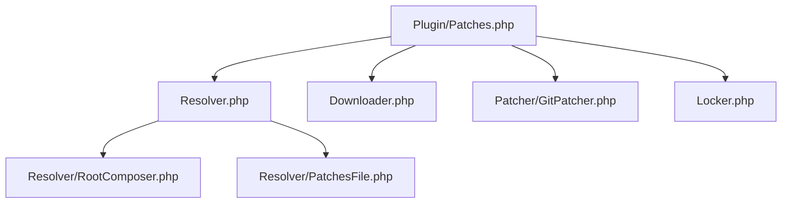

# cweagans/composer-patches

> Composer plugin that applies local or remote patches to PHP dependencies, for developers.

## The problem
Fixing a third-party dependency without waiting for the upstream fix forces you to fork it.

## What it actually does
The plugin listens to Composer events, collects patches from the root composer.json, a patches file and the dependencies, downloads them then applies them with a Git or free-form patcher. A locker keeps the state in the lock file.

## How it is wired

## Trying it
No command is documented in the README: it points to https://docs.cweagans.net/composer-patches.

## Cost and gotchas
Free, but requires PHP and Composer (not listed among the possible prerequisites). The README is very short (under 800 characters).

## What it is not
Not a dependency manager: it plugs into Composer.

## Alternatives
No alternative named in the README.

## For you
Ignore: a PHP ecosystem tool, with no use in a data / AI / MLOps chain.
