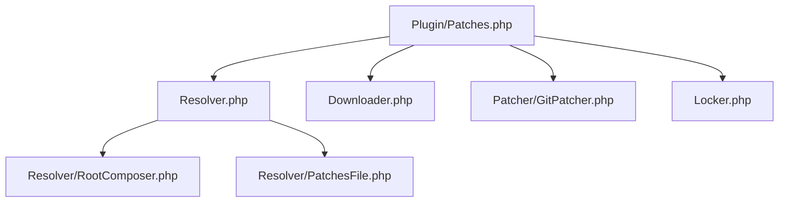

# cweagans/composer-patches

> Plugin Composer qui applique des correctifs locaux ou distants aux dépendances PHP, pour développeurs.

## Le problème
Corriger une dépendance tierce sans attendre le correctif amont oblige à la forker.

## Ce que ça fait vraiment
Le plugin écoute les événements de Composer, collecte les patchs depuis le composer.json racine, un fichier de patchs et les dépendances, les télécharge puis les applique avec un patcher Git ou libre. Un verrou garde l'état dans le fichier de lock.

## Comment c'est branché

## Essayer
Aucune commande n'est documentée dans le README : il renvoie à https://docs.cweagans.net/composer-patches.

## Coût et pièges
Gratuit, mais nécessite PHP et Composer (non listés dans les prérequis possibles). Le README est très court (moins de 800 caractères).

## Ce que ce n'est pas
Ce n'est pas un gestionnaire de dépendances : il s'ajoute à Composer.

## Alternatives
Aucune alternative nommée dans le README.

## Pour toi
À ignorer : outil de l'écosystème PHP, sans usage dans une chaîne data / IA / MLOps.

