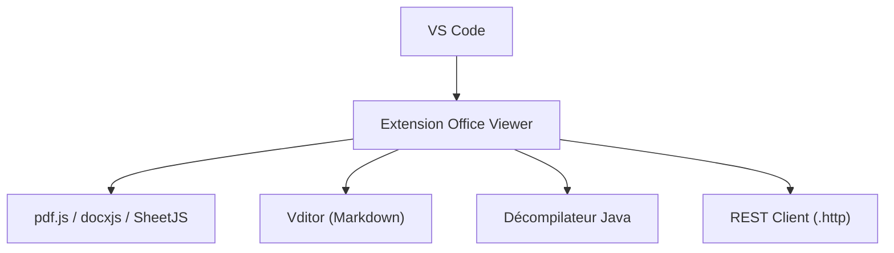

# cweijan/vscode-office

> VS Code extension that previews and edits Office files, PDFs, archives and Markdown inside the editor.

## The problem
Opening an .xlsx, a .docx or a PDF forces you to leave VS Code.

## What it actually does
It displays Excel, CSV, Word, PowerPoint, PDF, EPUB, PSD, fonts, archives (zip, jar, rar, 7z…) and decompiles Java `.class` files. It replaces the Markdown editor with a WYSIWYG editor with PDF, DOCX, HTML export, sends `.http` requests, offers a full Git history and icon themes.

## How it is wired
Simplified diagram based on the sheet, no diagram provided.



## Trying it
```bash
git clone https://github.com/cweijan/vscode-office.git
cd vscode-office
npm install
npm run dev
```

## Cost and gotchas
Free. Anonymous telemetry (Azure Application Insights) is active, and can be disabled with `vscode-office.enableTelemetry`. PDF export requires Chromium. Node 18+ for development.

## What it is not
Not an office suite: editing Word or PowerPoint documents remains limited compared with native software.

## Alternatives
No alternative named in the README.

## For you
Watch: handy for browsing .xlsx and CSV files without leaving the editor, remembering to disable telemetry.
