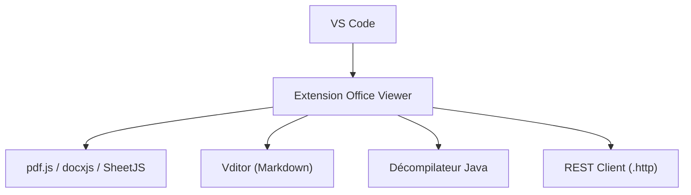

# cweijan/vscode-office

> Extension VS Code qui prévisualise et édite fichiers Office, PDF, archives et Markdown dans l'éditeur.

## Le problème
Ouvrir un .xlsx, un .docx ou un PDF oblige à quitter VS Code.

## Ce que ça fait vraiment
Elle affiche Excel, CSV, Word, PowerPoint, PDF, EPUB, PSD, polices, archives (zip, jar, rar, 7z…) et décompile les `.class` Java. Elle remplace l'éditeur Markdown par un éditeur WYSIWYG avec export PDF, DOCX, HTML, envoie des requêtes `.http`, offre un historique Git complet et des thèmes d'icônes.

## Comment c'est branché
Schéma simplifié d'après la fiche, sans diagramme fourni.



## Essayer
```bash
git clone https://github.com/cweijan/vscode-office.git
cd vscode-office
npm install
npm run dev
```

## Coût et pièges
Gratuit. Une télémétrie anonyme (Azure Application Insights) est active, désactivable par `vscode-office.enableTelemetry`. L'export PDF demande Chromium. Node 18+ pour développer.

## Ce que ce n'est pas
Ce n'est pas une suite bureautique : l'édition de documents Word ou PowerPoint reste limitée par rapport aux logiciels natifs.

## Alternatives
Aucune alternative nommée dans le README.

## Pour toi
À surveiller : pratique pour parcourir des .xlsx et CSV sans quitter l'éditeur, en pensant à désactiver la télémétrie.

