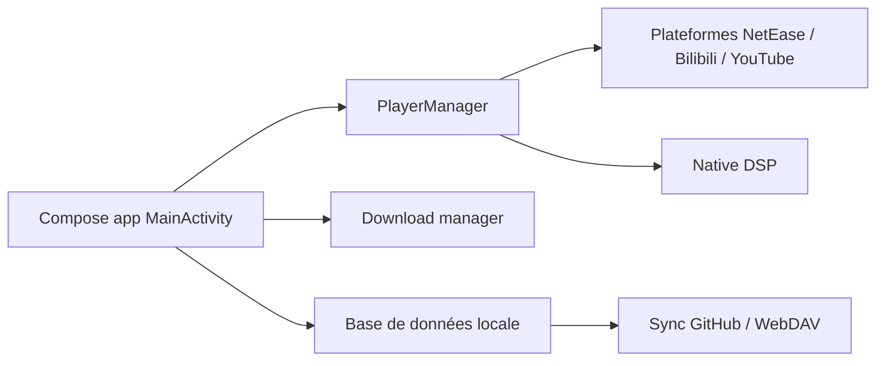

# cwuom/NeriPlayer

> Native Android audio player combining online sources, a local library, lyrics and self-hosted synchronization.

## The problem
Listening to music across several platforms and local files means juggling between apps, with no control over data or synchronization.

## What it actually does
A Jetpack Compose + Media3 application for Android 9+: playback from NetEase, Bilibili, YouTube Music and local files, resumable downloads, native DSP with equalizer and exclusive USB mode, word-by-word lyrics, widgets, synchronization to the user's own GitHub repository or WebDAV, and "listen together" through Cloudflare Workers.

## How it is wired


## Trying it
```bash
git clone --recursive https://github.com/cwuom/NeriPlayer.git
cd NeriPlayer
./gradlew :app:assembleDebug
adb install -r app/build/outputs/apk/debug/app-debug.apk
```

## Cost and gotchas
Free; JDK 17 (and JDK 21 for some tests), Android Studio. Provides no content: access depends on the user's third-party accounts. The README is very long and mostly in Chinese.

## What it is not
Not a music distribution service; the project states that it does not bypass DRM or restrictions. Releases are not described as stable.

## Alternatives
- Metrolist: YouTube Music client credited in the acknowledgements.

## For you
Ignore: consumer music app, outside the data/AI/MLOps scope.
