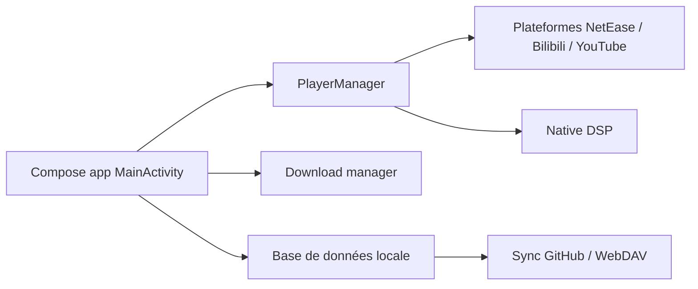

# cwuom/NeriPlayer

> Lecteur audio Android natif mêlant sources en ligne, bibliothèque locale, paroles et synchronisation auto-hébergée.

## Le problème
Écouter de la musique via plusieurs plateformes et fichiers locaux oblige à jongler entre applications, sans données ni synchronisation maîtrisées.

## Ce que ça fait vraiment
Application Jetpack Compose + Media3 pour Android 9+ : lecture NetEase, Bilibili, YouTube Music et fichiers locaux, téléchargements reprenables, DSP natif avec égaliseur et USB exclusif, paroles mot à mot, widgets, synchronisation vers un dépôt GitHub ou WebDAV de l'utilisateur, et « une écoute à plusieurs » via Cloudflare Workers.

## Comment c'est branché


## Essayer
```bash
git clone --recursive https://github.com/cwuom/NeriPlayer.git
cd NeriPlayer
./gradlew :app:assembleDebug
adb install -r app/build/outputs/apk/debug/app-debug.apk
```

## Coût et pièges
Gratuit ; JDK 17 (et JDK 21 pour certains tests), Android Studio. Ne fournit aucun contenu : l'accès dépend des comptes tiers de l'utilisateur. README très long et majoritairement en chinois.

## Ce que ce n'est pas
Pas un service de distribution musicale ; le projet précise ne pas contourner DRM ou restrictions. Les releases ne sont pas qualifiées de stables.

## Alternatives
- Metrolist : client YouTube Music cité en remerciements.

## Pour toi
À ignorer : application musicale grand public, hors périmètre data/IA/MLOps.

