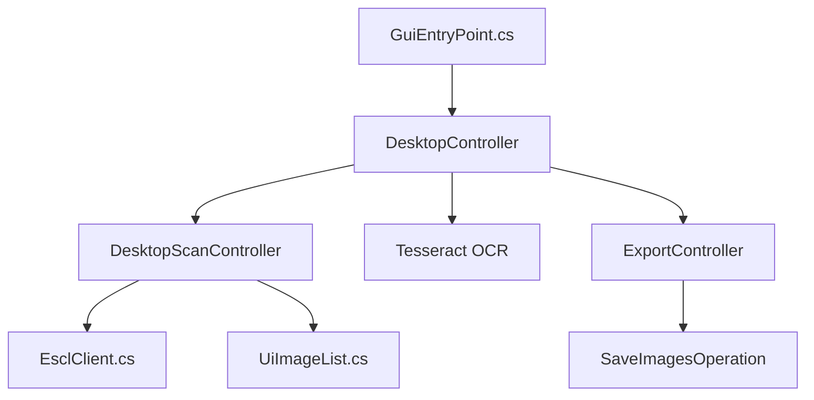

# cyanfish/naps2

> Simple document scanning application, with Tesseract OCR, on Windows, Mac and Linux.

## The problem
Scanning documents from a scanner and turning them into clean PDFs often requires the manufacturer's software.

## What it actually does
NAPS2 scans via WIA, TWAIN, SANE or eSCL, organizes pages, applies transformations and saves as PDF, TIFF, JPEG or PNG. OCR goes through Tesseract. It can send by email and share a scanner over the network via an eSCL server announced over mDNS. NAPS2.Sdk is a separate scanning library.

## How it is wired

## Trying it
No documented command: download from naps2.com; build instructions are in the GitHub wiki.

## Cost and gotchas
Free. License detected but not identified by GitHub: to be checked. Linux requires GTK 3.20+ and libsane.

## What it is not
Not a structured data extraction tool: OCR yields text inside a PDF.

## Alternatives
No alternative named in the README.

## For you
Worth watching: handy for scanning documents before OCR or RAG processing, but it remains a desktop app.
