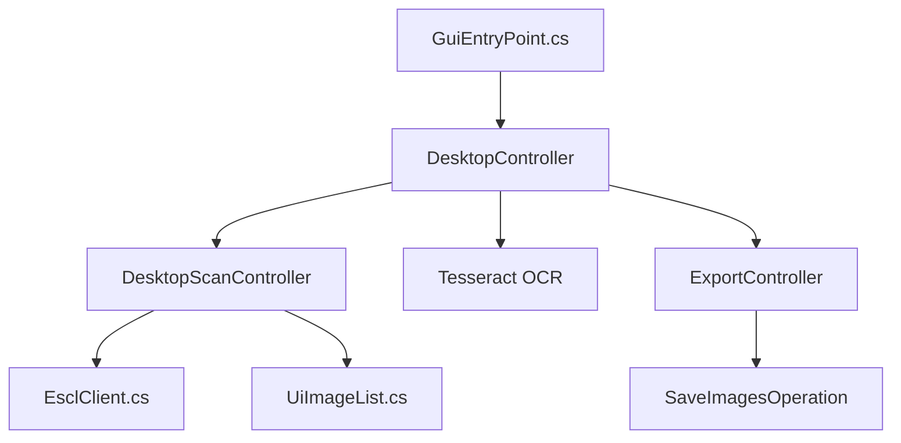

# cyanfish/naps2

> Application de numérisation de documents simple, avec OCR Tesseract, sur Windows, Mac et Linux.

## Le problème
Numériser des documents depuis un scanner et en faire des PDF propres demande souvent un logiciel constructeur.

## Ce que ça fait vraiment
NAPS2 numérise via WIA, TWAIN, SANE ou eSCL, organise les pages, applique des transformations et enregistre en PDF, TIFF, JPEG ou PNG. L'OCR passe par Tesseract. Il peut envoyer par email et partager un scanner sur le réseau via un serveur eSCL annoncé en mDNS. NAPS2.Sdk est une bibliothèque de numérisation à part.

## Comment c'est branché

## Essayer
Aucune commande documentée : télécharger depuis naps2.com ; instructions de construction dans le wiki GitHub.

## Coût et pièges
Gratuit. Licence détectée mais non identifiée par GitHub : à vérifier. Linux demande GTK 3.20+ et libsane.

## Ce que ce n'est pas
Pas un outil d'extraction de données structurées : l'OCR donne du texte dans un PDF.

## Alternatives
Aucune alternative nommée dans le README.

## Pour toi
Surveiller : pratique pour numériser des documents avant un traitement OCR ou RAG, mais ça reste une app de bureau.

