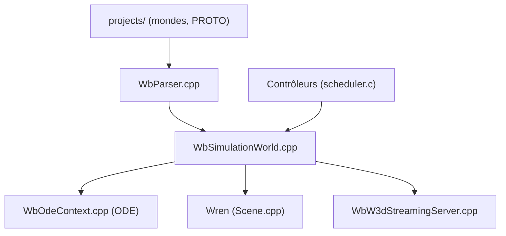

# cyberbotics/webots

> Open-source robot simulator to model, program and simulate robots and vehicles, beginner-friendly.

## The problem
Testing a robot on hardware is slow and expensive; a simulated environment with physics and sensors is needed.

## What it actually does
A Qt desktop application that loads worlds (.wbt) and PROTOs, simulates physics with ODE and renders the scene with the Wren engine (OpenGL). Controllers run in separate processes (C, C++, Python, Java, MATLAB). It streams the scene to a browser and integrates SUMO and OpenStreetMap.

## How it is wired


## Trying it
```bash
# Aucune commande dans le README : télécharger les binaires de la dernière version,
# ou compiler selon le wiki ; tutoriels indiqués dans le README.
```

## Cost and gotchas
Free; the company lives off paid support, training and consulting. An OpenGL-compatible GPU is desirable for rendering. Known bugs will not be fixed in the short term.

## What it is not
It is not a ready-to-use reinforcement learning framework: it is a general-purpose simulator, to be wired to your own controllers.

## Alternatives
No alternative named in the README.

## For you
Worth watching: mature and useful if you do robotics or embodied AI in simulation, of no interest for purely data work.
