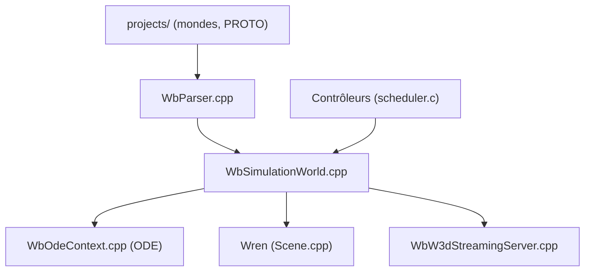

# cyberbotics/webots

> Simulateur de robots open source pour modéliser, programmer et simuler robots et véhicules, adapté aux débutants.

## Le problème
Tester un robot sur le matériel est lent et coûteux ; il faut un environnement simulé avec physique et capteurs.

## Ce que ça fait vraiment
Application de bureau Qt qui charge des mondes (.wbt) et des PROTO, simule la physique avec ODE et rend la scène avec le moteur Wren (OpenGL). Les contrôleurs tournent dans des processus séparés (C, C++, Python, Java, MATLAB). Elle diffuse la scène dans un navigateur et intègre SUMO et OpenStreetMap.

## Comment c'est branché


## Essayer
```bash
# Aucune commande dans le README : télécharger les binaires de la dernière version,
# ou compiler selon le wiki ; tutoriels indiqués dans le README.
```

## Coût et pièges
Gratuit ; la société vit de support, formation et conseil payants. Un GPU compatible OpenGL est souhaitable pour le rendu. Des bugs connus ne seront pas corrigés à court terme.

## Ce que ce n'est pas
Ce n'est pas un framework d'apprentissage par renforcement prêt à l'emploi : c'est un simulateur généraliste, à brancher soi-même à ses contrôleurs.

## Alternatives
Aucune alternative nommée dans le README.

## Pour toi
À surveiller : mature et utile si tu fais de la robotique ou de l'IA incarnée en simulation, sans intérêt pour un travail purement data.

