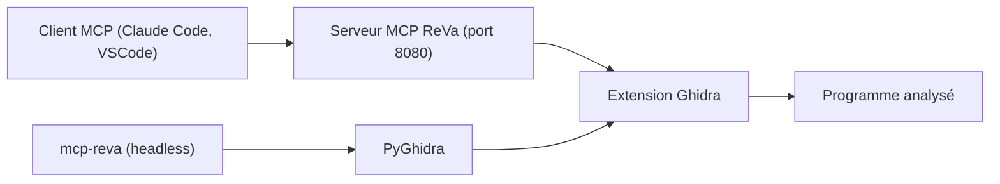

# cyberkaida/reverse-engineering-assistant

> Ghidra extension that exposes an MCP server to let an LLM reverse-engineer binaries.

## The problem
An LLM plugged into a decompiler quickly drowns its context with large binaries. Without suitable tools, it hallucinates or loses the thread.

## What it actually does
ReVa gives the model small Ghidra tools (decompilation, strings, cross-references, variable renaming) that return short fragments with context and links. Two modes: assistant (inside the Ghidra interface, port 8080 by default) or headless via `mcp-reva`, with ephemeral projects. The repository also ships a Claude Code plugin marketplace (binary triage, deep analysis, crypto, CTF).

## How it is wired
Simplified diagram based on the fiche, no diagram provided.


## Trying it
```bash
export GHIDRA_INSTALL_DIR=/path/to/ghidra
gradle install
claude mcp add --scope user --transport http ReVa -- http://localhost:8080/mcp/message
uv tool install reverse-engineering-assistant
claude mcp add --scope user ReVa -- mcp-reva
claude plugin marketplace add cyberkaida/reverse-engineering-assistant
```

## Cost and gotchas
You need Ghidra 12.0+ (Java 21, or Java 25 from Ghidra 12.2) and a paid LLM client at your expense. The PyGhidra scripting tools are enabled by default: on a public interface, enable the API key or turn them off.

## What it is not
It is not a standalone tool: it contains no model, it drives Ghidra for an MCP client. The answers remain those of the LLM, with its usual limits.

## Alternatives
No alternative named in the README.

## For you
Worth watching if you do binary analysis or CTF with an agent: the small-tools approach is sensible, but the project relies on a single maintainer.
