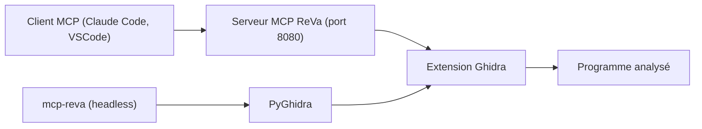

# cyberkaida/reverse-engineering-assistant

> Extension Ghidra qui expose un serveur MCP pour laisser un LLM faire de la rétro-ingénierie de binaires.

## Le problème
Un LLM branché sur un décompilateur noie vite son contexte avec de gros binaires. Sans outils adaptés, il hallucine ou perd le fil.

## Ce que ça fait vraiment
ReVa donne au modèle de petits outils Ghidra (décompilation, chaînes, références croisées, renommage de variables) qui renvoient des fragments courts avec du contexte et des liens. Deux modes : assistant (dans l'interface Ghidra, port 8080 par défaut) ou headless via `mcp-reva`, avec projets éphémères. Le dépôt embarque aussi un marketplace de plugins Claude Code (triage de binaire, analyse approfondie, crypto, CTF).

## Comment c'est branché
Schéma simplifié d'après la fiche, sans diagramme fourni.


## Essayer
```bash
export GHIDRA_INSTALL_DIR=/path/to/ghidra
gradle install
claude mcp add --scope user --transport http ReVa -- http://localhost:8080/mcp/message
uv tool install reverse-engineering-assistant
claude mcp add --scope user ReVa -- mcp-reva
claude plugin marketplace add cyberkaida/reverse-engineering-assistant
```

## Coût et pièges
Il faut Ghidra 12.0+ (Java 21, ou Java 25 à partir de Ghidra 12.2) et un client LLM payant à ta charge. Les outils de script PyGhidra sont actifs par défaut : sur une interface publique, active la clé d'API ou coupe-les.

## Ce que ce n'est pas
Ce n'est pas un outil autonome : il ne contient pas de modèle, il pilote Ghidra pour un client MCP. Les réponses restent celles du LLM, avec ses limites habituelles.

## Alternatives
Aucune alternative nommée dans le README.

## Pour toi
À surveiller si tu fais de l'analyse de binaires ou du CTF avec un agent : l'approche par petits outils est sensée, mais le projet repose sur un seul mainteneur.

