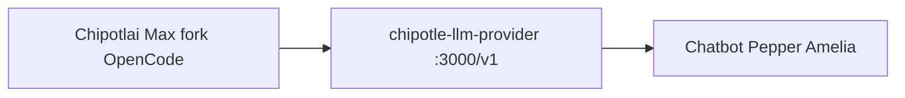

# cyberpapiii/chipotlai-max

> Parody fork of OpenCode that uses Chipotle's support chatbot as its default model.

## The problem
Getting free code inference without an API key by hijacking a corporate bot.

## What it actually does
Fork of OpenCode whose default model, `pepper-1`, goes through a local OpenAI-compatible proxy. This proxy talks to Chipotle's Pepper chatbot over WebSocket, according to the README. Other bots (Home Depot, Sephora, Nordstrom, Lowe's, IKEA, Expedia) are wired in but without an authorized adapter.

## How it is wired

Simplified diagram based on the sheet, no diagram provided.

## Trying it
```bash
git clone --recursive https://github.com/cyberpapiii/chipotlai-max.git
cd chipotlai-max
bun install
./start-chipotlai.sh
```

## Cost and gotchas
Free, but the README admits a probable violation of Chipotle's terms of use. The proxy can break at any time and anonymous sessions are limited.

## What it is not
Not a serious or lasting tool: a meme project, discouraged for any production code according to the README itself. License not identified by GitHub.

## Alternatives
`OpenCode`: the original agent, MIT-licensed, without hijacking.

## For you
Ignore: depends on a hijacked service that can disappear and exposes you to legal risk, with no reliable use.
