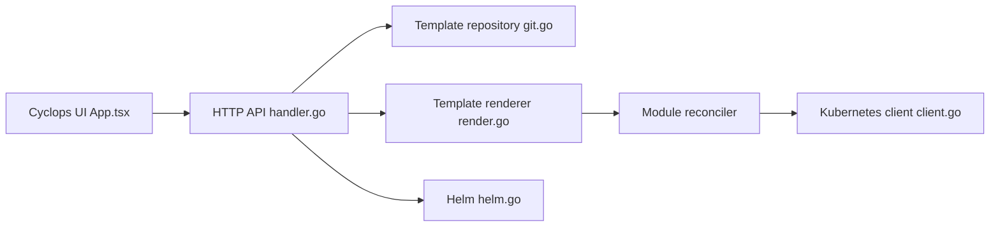

# cyclops-ui/cyclops

> Web interface to deploy Kubernetes applications from Helm charts, without writing YAML.

## The problem
Teams that are not Kubernetes experts have to edit risky YAML manifests to deploy or change an application.

## What it actually does
Cyclops generates UI forms from templates (Helm charts) and deploys "modules" into the cluster. A controller reconciles the modules into Kubernetes resources. The code also exposes a template store (Git repository), Helm release management, resource inspection, logs, exec into a pod, and module history. A `cyctl` CLI exists.

## How it is wired


## Trying it
```bash
kubectl apply -f https://raw.githubusercontent.com/cyclops-ui/cyclops/v0.21.1/install/cyclops-install.yaml && kubectl apply -f https://raw.githubusercontent.com/cyclops-ui/cyclops/v0.21.1/install/demo-templates.yaml
kubectl port-forward svc/cyclops-ui 3000:3000 -n cyclops
brew install cyctl
```
Then http://localhost:3000.

## Cost and gotchas
Free, but you need a Kubernetes cluster and prerequisites listed separately (not detailed here). The code contains a telemetry component; the README does not mention it. 84 open issues.

## What it is not
Neither a CI/CD tool nor a replacement for Helm: it builds on it. The forms are only as good as the templates written. Production installations are not documented in the README.

## Alternatives
The README mentions Glasskube as another way to install, not as a functional alternative. No other alternative named.

## For you
Worth watching: useful if you expose MLOps tool deployments to colleagues without Kubernetes expertise, but check telemetry and maturity first.
