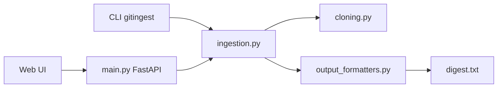

# cyclotruc/gitingest

> Turns a Git repository or a folder into a single text ready to paste into an LLM.

## The problem
Giving an LLM the context of a whole repository means copying dozens of files by hand and counting tokens.

## What it actually does
Produces a text digest: directory tree, file contents, statistics (size, token count). Available as a CLI, a Python package (sync and async), through a website, and by replacing a part of a GitHub URL (`hub` with `ingest`). Files in `.gitignore` are ignored by default. A private repository requires a GitHub token.

## How it is wired


## Trying it
```bash
pip install gitingest
gitingest /path/to/directory
gitingest https://github.com/coderamp-labs/gitingest
gitingest https://github.com/username/private-repo --token github_pat_...
```

## Cost and gotchas
Free. Self-hosting plans for PostHog and Sentry (environment variables; Sentry sends PII by default, set to `true`). A GitHub token is required for private repositories.

## What it is not
It is not a semantic search tool: it concatenates, it does not summarize. A large repository yields a digest that exceeds the context window.

## Alternatives
- Repomix: the NPM alternative cited by the README, if you prefer the JavaScript ecosystem.

## For you
Adopt it: one command, no prerequisites, and a clear gain as soon as you hand code to an LLM; still check the undeclared license.
