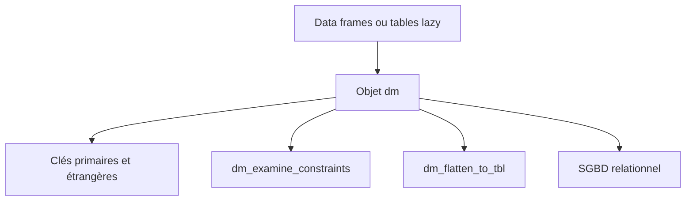

# cynkra/dm

> R package that organizes several relational tables or databases into a data model, with joins and constraints.

## The problem
Several data frames or database tables, joined by hand, with no keys and no consistency checks.

## What it actually does
- A `dm` object behaves like a named list of tables, with dplyr verbs.
- Primary and foreign keys, constraint checking (`dm_examine_constraints`), schema drawing (`dm_draw`).
- Joins that follow the keys, with `dm_flatten_to_tbl` renaming ambiguous columns.
- Can deploy the model to a relational DBMS.

## How it is wired

Simplified diagram based on the sheet; no diagram was provided.

## Trying it
```bash
Rscript -e 'install.packages("dm")'
Rscript -e 'pak::pak("cynkra/dm")'
```

## Cost and gotchas
Free. A license is present, but GitHub does not identify it; the README states MIT. Java, Ruby and others: no, it is R, so R must be installed. 211 open issues.

## What it is not
Not an ORM and not a Python tool: R only. It models and checks, without replacing the database.

## Alternatives
No alternative named in the README.

## For you
Worth watching: very good if you do analysis in R across several related tables; without R, it brings nothing.
