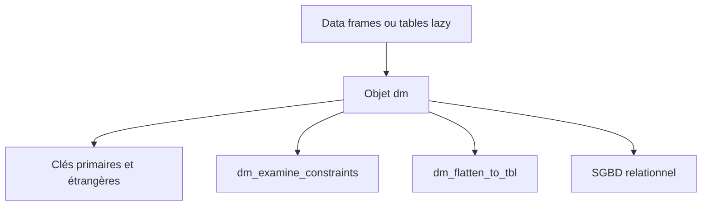

# cynkra/dm

> Paquet R qui organise plusieurs tables ou bases relationnelles en un modèle de données, avec jointures et contraintes.

## Le problème
Plusieurs data frames ou tables en base, jointes à la main, sans clés ni vérification de cohérence.

## Ce que ça fait vraiment
- Un objet `dm` se comporte comme une liste nommée de tables, avec les verbes de dplyr.
- Clés primaires et étrangères, contrôle des contraintes (`dm_examine_constraints`), dessin du schéma (`dm_draw`).
- Jointures qui suivent les clés, avec `dm_flatten_to_tbl` qui renomme les colonnes ambiguës.
- Peut déployer le modèle vers un SGBD relationnel.

## Comment c'est branché

Schéma simplifié d'après la fiche, sans diagramme fourni.

## Essayer
```bash
Rscript -e 'install.packages("dm")'
Rscript -e 'pak::pak("cynkra/dm")'
```

## Coût et pièges
Gratuit. La licence est présente, mais GitHub ne l'identifie pas ; le README annonce MIT. Java, Ruby et autres : non, c'est R, donc R installé. 211 issues ouvertes.

## Ce que ce n'est pas
Pas un ORM ni un outil Python : réservé à R. Il modélise et vérifie, sans remplacer la base.

## Alternatives
Aucune alternative nommée dans le README.

## Pour toi
À surveiller : très bon si tu fais de l'analyse sous R sur plusieurs tables liées ; sans R, il n'apporte rien.

