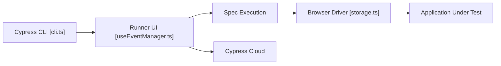

# cypress-io/cypress

> An end-to-end and component testing tool for anything that runs in a browser.

## The problem
Classic web tests are slow to write and unstable.

## What it actually does
Minimal README (under 800 characters, empty "What is Cypress?" section). The architecture describes: the CLI opens or launches the application, the runner picks a spec, runs it through the browser driver and reports the results. React, Vue, Angular, Svelte adapters and Vite/Webpack servers exist.

## How it is wired


## Trying it
```bash
npm install cypress --save-dev
yarn add cypress --dev
pnpm add cypress --save-dev
```

## Cost and gotchas
The runner is free; Cypress Cloud pricing is not documented in the README.

## What it is not
It is not a unit-testing or model-testing tool. Minimal sheet: the rest (commands, options) is not in the README.

## Alternatives
No alternative named in the README.

## For you
Worth watching: useful only if you test a web interface of your AI product; otherwise out of scope.
