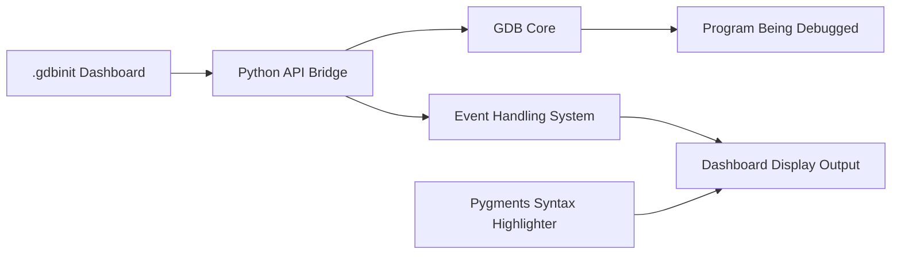

# cyrus-and/gdb-dashboard

> `.gdbinit` file that displays a modular dashboard in GDB, for C/C++ developers.

## The problem
Inspecting a program's state under GDB requires chaining many commands at every stop.

## What it actually does
A single `.gdbinit` written with GDB's Python API automatically displays a dashboard each time the program stops.
No GDB command is redefined: everything goes through the `dashboard` command.
Optional syntax highlighting via Pygments.
Detailed documentation on the wiki.

## How it is wired


## Trying it
```bash
wget -P ~ https://github.com/cyrus-and/gdb-dashboard/raw/master/.gdbinit
pip install pygments
```

## Cost and gotchas
Free, nothing to configure; it replaces your existing `~/.gdbinit`, so merge them if you have one.

## What it is not
Not a graphical debugger or an IDE: it is a text overlay on GDB.
Useless for Python or high-level ML code.

## Alternatives
No alternative named in the README.

## For you
Ignore: relevant only if you debug native C/C++ or CUDA extensions, which is rare in day-to-day data/MLOps work.
