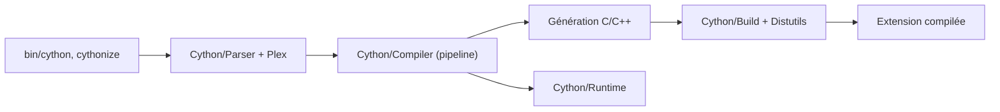

# cython/cython

> Compiler that translates Python (with C types) into C/C++ to speed up code or wrap C libraries.

## The problem
Pure Python is slow on numerical loops, and writing C extensions by hand is painful.

## What it actually does
The compiler parses the code (`Cython/Parser`, `Plex`), applies a pipeline of transformations and type inference (`Cython/Compiler`), then generates C or C++ compiled as a CPython extension. It also provides build tools (`cythonize`, Distutils), a debugger and headers for C APIs. It calls C functions directly.

## How it is wired


## Trying it
```bash
pip install Cython
```

## Cost and gotchas
Free, but you need a C compiler. The README gives no further usage details; everything goes through the online documentation.

## What it is not
Not a JIT compiler: the code is compiled ahead of time. The README itself compares it with PyPy, Numba, Pythran, mypyc and Nuitka, and does not claim that Cython always replaces them.

## Alternatives
Numba (JIT for NumPy code), PyPy (runtime with a JIT), Pythran (numerical, often used as a Cython backend), mypyc, Nuitka.

## For you
Adopt: it is the building block behind much of the Python scientific ecosystem, and knowing it helps to speed up a bottleneck or wrap a C library.
