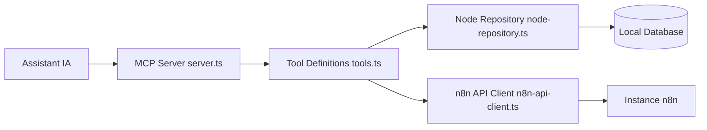

# czlonkowski/n8n-mcp

> MCP server that gives an AI assistant knowledge of n8n nodes to build and validate workflows.

## The problem
An LLM invents n8n node parameters and produces workflows that fail at runtime. Without a structured catalog, it fumbles around.

## What it actually does
Exposes through MCP the documentation, properties and operations of 3,143 nodes (841 core, 2,302 community), 2,352 workflow templates and configuration examples. Provides validation tools (node, workflow, expressions). With `N8N_API_URL` and `N8N_API_KEY`, 21 management tools create, modify, test and audit the workflows of a real n8n instance.

## How it is wired


## Trying it
```bash
# Hébergé : dashboard.n8n-mcp.com (palier gratuit : 100 appels d'outils/jour)
# Variables pour les outils de gestion
N8N_API_URL=...
N8N_API_KEY=...
# Mode lecture seule
DISABLED_TOOLS=n8n_create_workflow,n8n_update_full_workflow,n8n_update_partial_workflow,n8n_delete_workflow,n8n_autofix_workflow,n8n_deploy_template,n8n_test_workflow,n8n_manage_credentials,n8n_manage_datatable
```

## Cost and gotchas
The hosted free tier is limited to 100 calls/day; self-hosting (npx, Docker) avoids the quota. The write tools touch real workflows: the README warns never to edit production directly.

## What it is not
Not n8n itself nor an execution engine. The management tools require an n8n instance and an API key. A Privacy & Telemetry section is documented: read what is collected.

## Alternatives
- n8n-skills (czlonkowski): complements this server with usage skills, does not replace it.
- Native n8n instance MCP: the README connects to it for agents and resource resolution.

## For you
Adopt if you automate with n8n and an agent: it is the knowledge layer that prevents broken workflows, with a read-only mode to limit risk.
