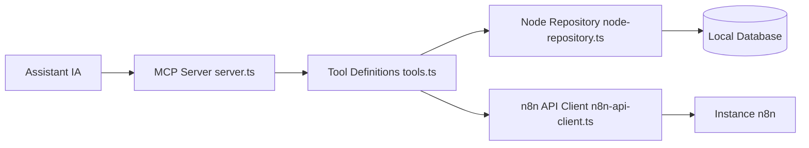

# czlonkowski/n8n-mcp

> Serveur MCP qui donne à un assistant IA la connaissance des nœuds n8n pour construire et valider des workflows.

## Le problème
Un LLM invente des paramètres de nœuds n8n et produit des workflows qui échouent à l'exécution. Sans catalogue structuré, il tâtonne.

## Ce que ça fait vraiment
Expose via MCP la documentation, les propriétés et opérations de 3 143 nœuds (841 cœur, 2 302 communautaires), 2 352 modèles de workflows et des exemples de configuration. Fournit des outils de validation (nœud, workflow, expressions). Avec `N8N_API_URL` et `N8N_API_KEY`, 21 outils de gestion créent, modifient, testent et auditent les workflows d'une instance n8n réelle.

## Comment c'est branché


## Essayer
```bash
# Hébergé : dashboard.n8n-mcp.com (palier gratuit : 100 appels d'outils/jour)
# Variables pour les outils de gestion
N8N_API_URL=...
N8N_API_KEY=...
# Mode lecture seule
DISABLED_TOOLS=n8n_create_workflow,n8n_update_full_workflow,n8n_update_partial_workflow,n8n_delete_workflow,n8n_autofix_workflow,n8n_deploy_template,n8n_test_workflow,n8n_manage_credentials,n8n_manage_datatable
```

## Coût et pièges
Palier hébergé gratuit limité à 100 appels/jour ; l'auto-hébergement (npx, Docker) évite le quota. Les outils d'écriture touchent de vrais workflows : le README avertit de ne jamais éditer la production directement.

## Ce que ce n'est pas
Pas n8n lui-même ni un moteur d'exécution. Les outils de gestion exigent une instance n8n et une clé d'API. Un Privacy & Telemetry est documenté : lire ce qui est collecté.

## Alternatives
- n8n-skills (czlonkowski) : complète ce serveur avec des skills d'usage, ne le remplace pas.
- MCP natif d'instance n8n : le README s'y connecte pour agents et résolution de ressources.

## Pour toi
À adopter si tu automatises avec n8n et un agent : c'est la couche de connaissance qui évite les workflows cassés, avec un mode lecture seule pour limiter les risques.

