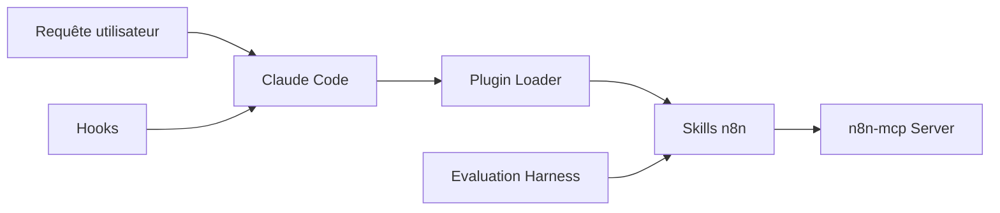

# czlonkowski/n8n-skills

> Fourteen Claude Code skills to build reliable n8n workflows with the n8n-mcp server.

## The problem
An agent misuses the n8n-mcp tools: wrong expressions, validation error loops, wrong nodes.

## What it actually does
Auto-activating skills: expression syntax, MCP tool usage, workflow patterns, validation, node configuration, JavaScript/Python Code, Code Tool node, error handling, binaries, sub-workflows, AI agents, multi-instance, n8n self-hosting. A router skill and hooks (SessionStart, PreToolUse, PostToolUse) remind the agent of the right guidance.

## How it is wired


## Trying it
```bash
/plugin install czlonkowski/n8n-skills
/plugin marketplace add czlonkowski/n8n-skills
cp -r n8n-skills/skills/* ~/.claude/skills/
```

## Cost and gotchas
Free, but requires n8n-mcp configured in `.mcp.json`. The hooks only work in the Claude Code or Codex plugin, not on Claude.ai.

## What it is not
Not a server: these are Markdown instructions. Discrepancy: the code analysis mentions seven skills, the README fourteen. Commercial link with AiAdvisors by the same author.

## Alternatives
- czlonkowski/n8n-mcp: the server these skills depend on.

## For you
Adopt it if you use n8n-mcp: these skills fix the most frequent errors for almost no cost.
