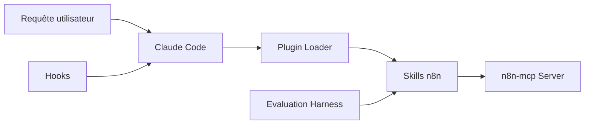

# czlonkowski/n8n-skills

> Quatorze skills Claude Code pour construire des workflows n8n fiables avec le serveur n8n-mcp.

## Le problème
Un agent utilise mal les outils n8n-mcp : expressions fausses, boucles d'erreurs de validation, mauvais nœuds.

## Ce que ça fait vraiment
Skills d'activation automatique : syntaxe d'expressions, usage des outils MCP, motifs de workflows, validation, configuration de nœuds, Code JavaScript/Python, nœud Code Tool, gestion d'erreurs, binaires, sous-workflows, agents IA, multi-instances, auto-hébergement de n8n. Un skill routeur et des hooks (SessionStart, PreToolUse, PostToolUse) rappellent la bonne consigne.

## Comment c'est branché


## Essayer
```bash
/plugin install czlonkowski/n8n-skills
/plugin marketplace add czlonkowski/n8n-skills
cp -r n8n-skills/skills/* ~/.claude/skills/
```

## Coût et pièges
Gratuit, mais exige n8n-mcp configuré dans `.mcp.json`. Les hooks ne fonctionnent que dans le plugin Claude Code ou Codex, pas sur Claude.ai.

## Ce que ce n'est pas
Pas un serveur : ce sont des consignes en Markdown. Divergence : l'analyse du code parle de sept skills, le README de quatorze. Lien commercial avec AiAdvisors du même auteur.

## Alternatives
- czlonkowski/n8n-mcp : le serveur dont ces skills dépendent.

## Pour toi
À adopter si tu utilises n8n-mcp : ces skills corrigent les erreurs les plus fréquentes pour presque aucun coût.

