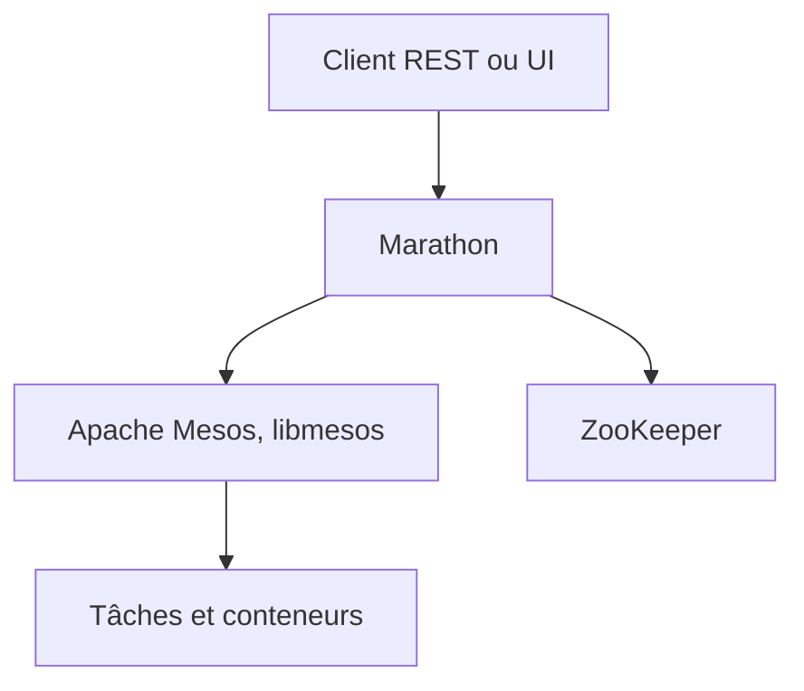

# d2iq-archive/marathon

> Container orchestrator for Apache Mesos with a REST API, now end-of-life.

## The problem
Launching, scaling and restarting applications on a Mesos cluster required a dedicated scheduler.

## What it actually does
Marathon, written in Scala, starts and stops applications through a REST API. Several copies run in high availability with a single elected leader. Placement constraints, HTTP or TCP health checks, service discovery via HAProxy, Prometheus or StatsD metrics. State is stored in Mesos, with ZooKeeper.

## How it is wired
Simplified diagram based on the sheet, no diagram provided.


## Trying it
```bash
git clone https://github.com/mesosphere/marathon.git
cd marathon
sbt 'run --master localhost:5050 --zk zk://localhost:2181/marathon'
```

## Cost and gotchas
Free, but it needs a JDK 1.8+, sbt, libmesos and ZooKeeper (none of them appear in the prerequisites list). DC/OS support ended on October 31, 2021; last push in 2022.

## What it is not
It is not a living project nor an equivalent of Kubernetes. Issue tracking was done in JIRA, no longer on GitHub.

## Alternatives
No alternative named in the README.

## For you
Ignore: abandoned Mesos orchestrator, outside current MLOps practice.
