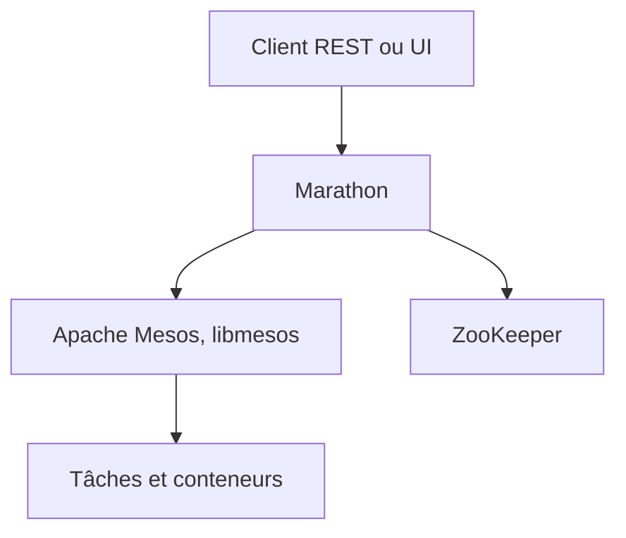

# d2iq-archive/marathon

> Orchestrateur de conteneurs pour Apache Mesos avec API REST, désormais en fin de vie.

## Le problème
Lancer, mettre à l'échelle et relancer des applications sur un cluster Mesos demandait un ordonnanceur dédié.

## Ce que ça fait vraiment
Marathon, écrit en Scala, démarre et arrête des applications via une API REST. Plusieurs copies tournent en haute disponibilité avec un seul chef élu. Contraintes de placement, contrôles de santé HTTP ou TCP, découverte de services via HAProxy, métriques Prometheus ou StatsD. L'état est stocké dans Mesos, avec ZooKeeper.

## Comment c'est branché
Schéma simplifié d'après la fiche, sans diagramme fourni.


## Essayer
```bash
git clone https://github.com/mesosphere/marathon.git
cd marathon
sbt 'run --master localhost:5050 --zk zk://localhost:2181/marathon'
```

## Coût et pièges
Gratuit, mais il faut un JDK 1.8+, sbt, libmesos et ZooKeeper (aucun n'existe dans la liste des prérequis). Le support de DC/OS a pris fin le 31 octobre 2021 ; dernier push en 2022.

## Ce que ce n'est pas
Ce n'est pas un projet vivant ni un équivalent de Kubernetes. Le suivi des tickets se faisait dans JIRA, plus sur GitHub.

## Alternatives
Aucune alternative nommée dans le README.

## Pour toi
À ignorer : orchestrateur Mesos abandonné, hors des pratiques MLOps actuelles.

