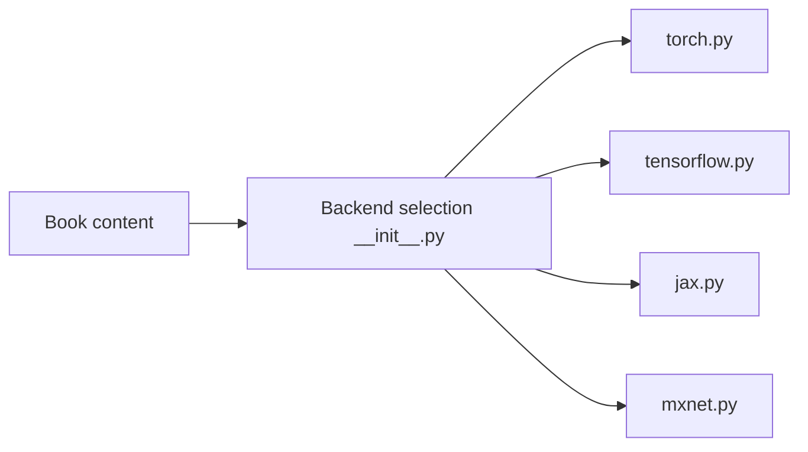

# d2l-ai/d2l-en

> Interactive deep learning textbook in English, multi-framework notebooks, for students and practitioners.

## The problem
Deep learning courses separate theory, math and code. This book brings them together in executable notebooks.

## What it actually does
The book is written as Jupyter notebooks mixing exposition, figures, math and standalone code. Content: basics, training, vision, language models, advanced topics, math and tooling appendices. Four helper modules (PyTorch, TensorFlow, JAX, MXNet) offer parallel APIs. A forum accompanies the book.

## How it is wired


## Trying it
```bash
# Aucune commande documentée dans ce README :
# lecture sur le site du livre, notebooks dans le dépôt.
```

## Cost and gotchas
Free. License present but not identified by GitHub. Last push in August 2024. Required framework versions are not documented.

## What it is not
It is not a package to install in production: the helpers serve only the book's examples.

## Alternatives
- d2l-ai/d2l-zh: the Chinese edition of the same book.

## For you
Worth watching: a well-recognized learning reference, but the repo has been inactive since 2024 and the license must be checked before reuse.
