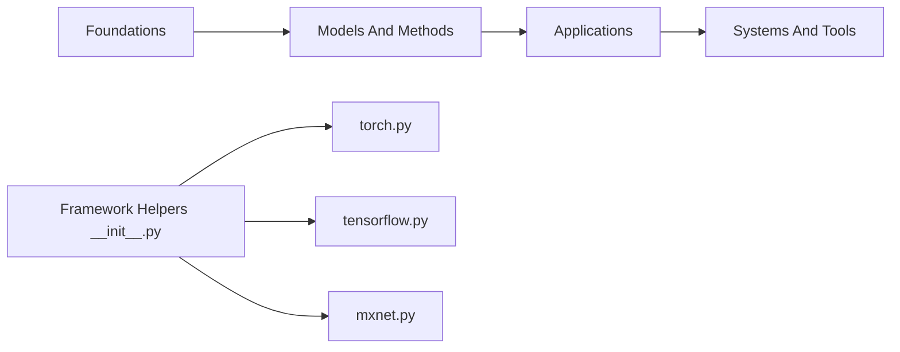

# d2l-ai/d2l-zh

> Free deep learning textbook in Chinese, with executable code, for students and engineers.

## The problem
Learning deep learning requires juggling between theoretical courses, mathematics, and scattered code. This manual brings together concepts, mathematics, and implementation in a single resource.

## What it actually does
A book (2nd edition on zh.D2L.ai) that combines text, formulas, and code in each chapter. The chapters range from the basics (linear networks, multi-layer perceptrons) to CNNs, RNNs, attention/Transformers, as well as topics like computer vision, natural language processing, performance, and deployment. A layer of helper functions, `d2l`, provides adapters for PyTorch, TensorFlow, MXNet, and Paddle. A forum complements the book.

## How it is wired


## Trying it
```bash
# Aucune commande documentée dans ce README :
# lecture en ligne sur zh.D2L.ai (2e édition) ou zh-v1.D2L.ai (1re édition).
```

## Cost and gotchas
Free lecture. The README does not mention any required hardware to run the code. The last commit was in July 2024.

## What it is not
This is not a library to be installed: the `d2l` helpers are only used for the examples in the book. The README indicates that new versions will be written in English and then translated back into Chinese: this version is therefore lagging behind.

## Alternatives
- d2l-ai/d2l-en: The English edition, where new content is now being written.

## For you
Surveiller: An excellent learning tool if you are learning Chinese, but the content has been frozen since 2024, and the English edition is preferred for recent content.
