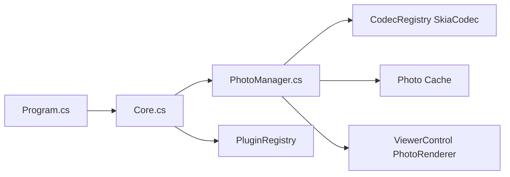

# d2phap/ImageGlass

> Cross-platform photo viewer that reads more than 90 formats, with simple editing tools.

## The problem
Default viewers are slow or cannot read WEBP, JXL, HEIC, AVIF, HDR or raw files.

## What it actually does
Fast navigation with an adaptive cache, native SVG rendering, animated GIF/WEBP, color management, slideshow, rotation, cropping, resizing, color picker. The codec registry relies on Skia; plugins and external tools go through ImageGlass.SDK. Version 10 for Windows, macOS (Apple Silicon) and Linux X11.

## How it is wired

## Trying it
No command documented in the README: download from imageglass.org or GitHub.

## Cost and gotchas
The basic edition is free; the Pro version (managed deployment, locked settings) is paid. Fraudulent repositories imitate the project: only download from the official sources.

## What it is not
Not a full image editor. Version 9 and version 10 coexist in the repository.

## Alternatives
No alternative named in the README.

## For you
Ignore: desktop convenience unrelated to your field; license not identified and a single main maintainer.
