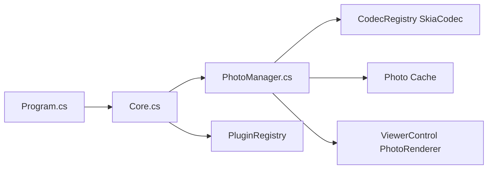

# d2phap/ImageGlass

> Visionneuse de photos multiplateforme lisant plus de 90 formats, avec outils d'édition simples.

## Le problème
Les visionneuses par défaut sont lentes ou ne lisent pas WEBP, JXL, HEIC, AVIF, HDR ou le brut.

## Ce que ça fait vraiment
Navigation rapide avec cache adaptatif, rendu SVG natif, GIF/WEBP animés, gestion des couleurs, diaporama, rotation, recadrage, redimensionnement, sélecteur de couleur. Le registre de codecs s'appuie sur Skia ; plugins et outils externes via ImageGlass.SDK. Version 10 pour Windows, macOS (Apple Silicon) et Linux X11.

## Comment c'est branché

## Essayer
Aucune commande documentée dans le README : téléchargement depuis imageglass.org ou GitHub.

## Coût et pièges
Édition de base gratuite ; la version Pro (déploiement géré, réglages verrouillés) est payante. Des dépôts frauduleux imitent le projet : ne télécharger que depuis les sources officielles.

## Ce que ce n'est pas
Pas un éditeur d'images complet. Version 9 et version 10 coexistent dans le dépôt.

## Alternatives
Aucune alternative nommée dans le README.

## Pour toi
Ignorer : confort de bureau sans rapport avec ton métier ; licence non identifiée et mainteneur principal unique.

