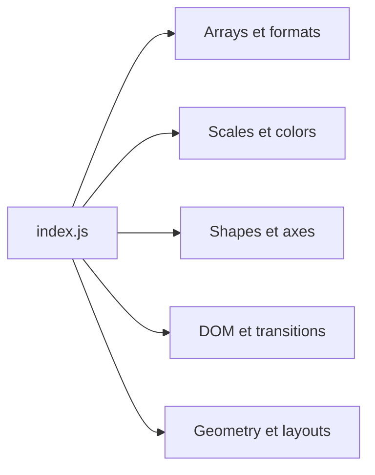

# d3/d3

> JavaScript data visualization library that uses direct DOM manipulation and SVG to create visualizations.

## The problem
Creating custom charts within a browser requires linking data and graphical elements.

## What it actually does
Very short README (less than 800 characters): minimal description. Based on the architecture, the `index.js` entry point re-exports specialized modules: arrays and formats, data loading, scales and colors, shapes and axes, DOM and transitions, zoom, time, geometry, and layout. The implementations have not been sampled.

## How it is wired


## Trying it
```bash
# aucune commande documentée dans le README
```

## Cost and gotchas
Free, ISC license. No prerequisites are specified in the README file.

## What it is not
Not a library of ready-made graphics: the approach is very basic. The template remains incomplete due to a lack of content.

## Alternatives
No alternative is specified in the README file.

## For you
This is recommended if you are creating a custom dashboard or visualization; for a quick and easy solution, a higher-level library is sufficient.
