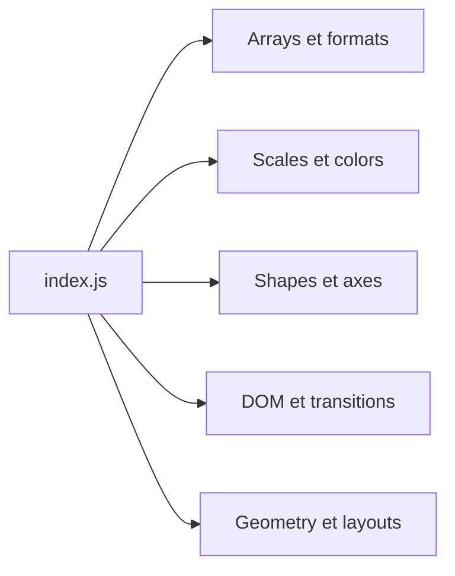

# d3/d3

> Bibliothèque JavaScript de visualisation de données par manipulation directe du DOM et de SVG.

## Le problème
Dessiner des graphiques sur mesure dans le navigateur demande de lier données et éléments graphiques.

## Ce que ça fait vraiment
README très court (moins de 800 caractères) : fiche minimale. D'après l'architecture, le point d'entrée `index.js` réexporte des paquets spécialisés : tableaux et formats, chargement de données, échelles et couleurs, formes et axes, DOM et transitions, zoom, temps, géométrie et mises en page. Les implémentations n'ont pas été échantillonnées.

## Comment c'est branché


## Essayer
```bash
# aucune commande documentée dans le README
```

## Coût et pièges
Gratuit, licence ISC. Aucun prérequis déclaré dans le README.

## Ce que ce n'est pas
Pas une bibliothèque de graphiques prêts à l'emploi : l'approche est bas niveau. La fiche reste incomplète faute de matière.

## Alternatives
Aucune alternative nommée dans le README.

## Pour toi
À adopter si tu construis un tableau de bord ou une visualisation sur mesure ; pour un graphique rapide, une bibliothèque de plus haut niveau suffit.

