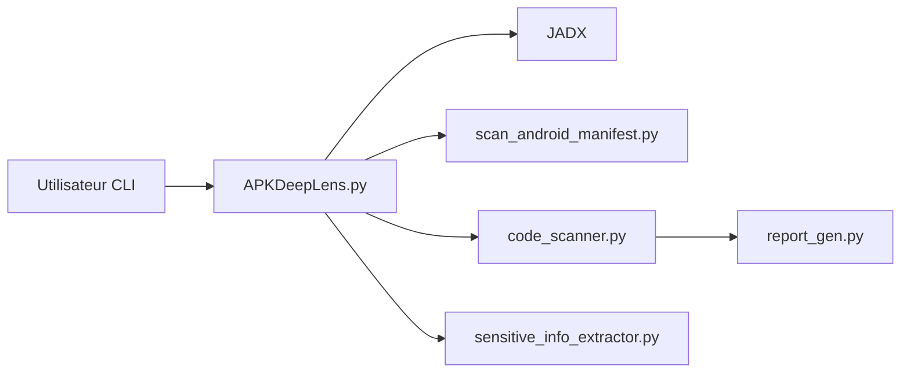

# d78ui98/APKDeepLens

> Static Android APK analyzer that detects vulnerabilities according to the OWASP Mobile Top 10.

## The problem
Manually auditing an APK (manifest, hardcoded secrets, TLS misconfiguration) is slow and inconsistent.

## What it actually does
Decompiles the APK with JADX, analyzes the manifest and the Java/Kotlin/XML code, and looks for secrets, insecure URLs, weak crypto, WebView, SSL and dynamic execution issues. Each finding carries a severity and an OWASP category, exported as JSON, HTML, PDF or TXT, with a JSON output designed for CI.

## How it is wired


## Trying it
```bash
git clone https://github.com/d78ui98/APKDeepLens.git
cd APKDeepLens
python3 -m venv venv
source venv/bin/activate
pip install -r requirements.txt
python APKDeepLens.py -apk app.apk -report html
```

## Cost and gotchas
Free; Python 3.10+ and Java required. A static pattern-based scan produces false positives; a filter list is provided.

## What it is not
No dynamic analysis. Does not replace a penetration test.

## Alternatives
No alternative cited in the README.

## For you
Ignore: mobile security is outside the data/AI scope; only useful if you audit Android applications.
