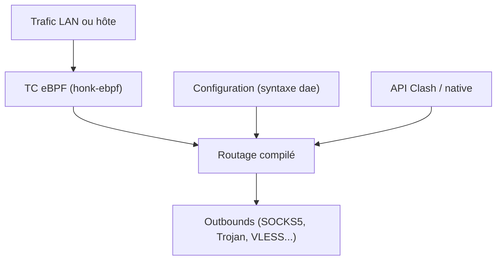

# daeuniverse/honk

> Experimental transparent proxy engine for Linux, written in Rust with an eBPF data path.

## The problem
Route the traffic of a local network or a host through proxies without configuring each application.

## What it actually does
Captures TCP/UDP traffic with TC eBPF and directs it according to compiled rules to SOCKS5, Shadowsocks, Trojan, Hysteria2, VMess, VLESS and other outbounds. Offers groups (Selector, URLTest, LoadBalance, Fallback, Score), DNS (UDP, TCP, DoT, DoH, DoQ), a Clash-compatible REST API and the `honk-tool` utility. Follows dae's configuration syntax.

## How it is wired
Simplified diagram based on the sheet, no diagram provided.

## Trying it
No command in the README: download an archive from Releases and follow the getting-started guide.

## Cost and gotchas
Free, GPL-3.0. Requires root, Linux 6.12+, bpffs and specific kernel options. The initial deployment changes network hooks, namespaces and sysctl: keep a fallback access. Early alpha version.

## What it is not
It is not a cross-platform client: no Windows or macOS datapath, no FakeIP and no full parity with mihomo.

## Alternatives
dae and sing-box are cited as sources of inspiration.

## For you
Ignore: experimental network proxy on Linux, outside your scope and judged too young for infrastructure.
