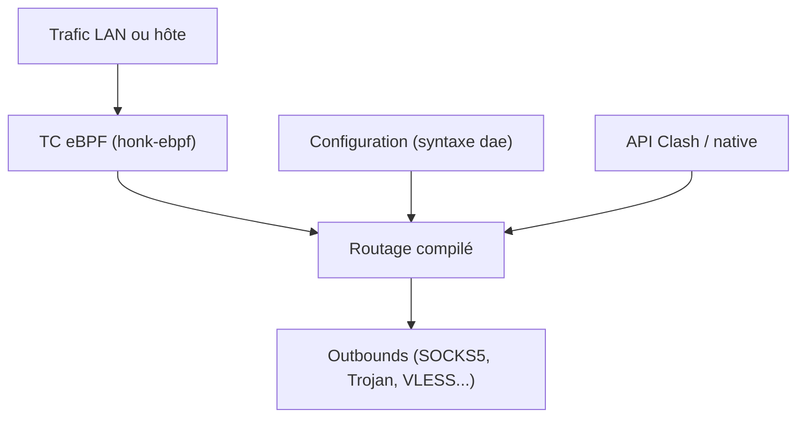

# daeuniverse/honk

> Moteur expérimental de proxy transparent pour Linux, écrit en Rust avec un chemin de données eBPF.

## Le problème
Router le trafic d'un réseau local ou d'un hôte à travers des proxys sans configurer chaque application.

## Ce que ça fait vraiment
Capture le trafic TCP/UDP par TC eBPF et le dirige selon des règles compilées vers des sorties SOCKS5, Shadowsocks, Trojan, Hysteria2, VMess, VLESS et autres. Propose des groupes (Selector, URLTest, LoadBalance, Fallback, Score), du DNS (UDP, TCP, DoT, DoH, DoQ), une API REST compatible Clash et l'outil `honk-tool`. Suit la syntaxe de configuration de dae.

## Comment c'est branché
Schéma simplifié d'après la fiche, sans diagramme fourni.

## Essayer
Aucune commande dans le README : télécharger une archive depuis Releases et suivre le guide de démarrage.

## Coût et pièges
Gratuit, GPL-3.0. Exige root, Linux 6.12+, bpffs et des options noyau précises. Le déploiement initial modifie crochets réseau, espaces de noms et sysctl : garder un accès de secours. Version alpha précoce.

## Ce que ce n'est pas
Ce n'est pas un client multiplateforme : pas de datapath Windows ou macOS, pas de FakeIP ni de parité complète avec mihomo.

## Alternatives
dae et sing-box sont cités comme sources d'inspiration.

## Pour toi
À ignorer : proxy réseau expérimental sous Linux, hors de ton périmètre et jugé trop jeune pour de l'infra.

