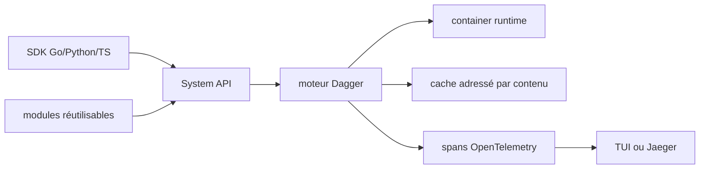

# dagger/dagger

> Software delivery automation engine where the steps are typed code, not YAML.

## The problem
A CI pipeline written in proprietary YAML can only be tested by pushing to the server,
and cannot be replayed identically locally.

## What it actually does
Provides an execution engine and a multi-language system API to orchestrate
containers, filesystems, secrets, Git repositories and network tunnels, each
operation typed and composable. Native SDKs for Go, Python, TypeScript, PHP, Java,
.NET, Elixir and Rust, all generated from the API schema. Custom artifact types
with encapsulated state, content-addressed, passable between languages
and between modules without serialization. Incremental execution: each operation is
keyed by its inputs, the cache is content-addressed and applies to local
and CI alike. Each operation emits OpenTelemetry spans, with a live TUI
or export to Jaeger, Honeycomb or any OTel backend.

## How it is wired


## Trying it
```bash
brew install dagger/tap/dagger
```

## Cost and gotchas
Free, the only dependency being a Linux container runtime (Docker Desktop on macOS
and Windows). The README gives no details on the cloud offering or what it charges,
even though it mentions running "directly in the cloud".

## What it is not
Not a CI server: it runs inside your existing CI, it does not replace it.
No mode without containers. The README is a sales pitch, not a guide: only one
command appears in it, everything else points to the Quickstart.

## Alternatives
- No alternative repository named in the README.

## For you
Interesting for making a data pipeline replayable identically locally;
the learning cost is real. Keep watching.
