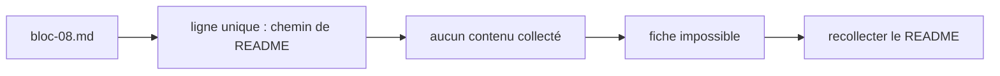

# dagster-io/dagster

> Repository not read: the block contains no usable README content.

## The problem
Not documented here.

## What it actually does
**No summary possible.** For this repository, the block `bloc-08.md` contains only
the line `python_modules/dagster/README.md` — a file path, not its content.
The README was therefore not collected and nothing can be described without making it up.

## How it is wired

## Trying it
No documented command: the README content is absent from the block.

## Cost and gotchas
Not documented here.

## What it is not
This is not a sheet: it is a flag. The pipeline evidently followed a README
redirect to `python_modules/dagster/README.md` without retrieving its
content. It must be recollected before the repository can be judged.

## Alternatives
Not documented here.

## For you
Nothing to decide until the README is retrieved.
