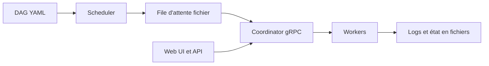

# dagu-org/dagu

> Local workflow engine in a single binary, for automating scripts without a heavy platform.

## The problem
Cron offers no dependencies, no retries and no history; Airflow or Temporal impose a platform or an SDK.

## What it actually does
DAGs are written in YAML: shell commands, Docker containers, Kubernetes Jobs, SSH, HTTP, SQL, dbt, DuckDB. Cron scheduling with catch-up, retries, human tasks, masked secrets, parallel sub-DAGs, web interface, built-in MCP server. Execution on a single server or with gRPC workers; state in files, no database.

## How it is wired


## Trying it
```sh
brew install dagu
dagu start hello.yaml
dagu start-all --dags .
docker run --rm -v ~/.dagu:/var/lib/dagu -p 8080:8080 ghcr.io/dagucloud/dagu:latest dagu start-all
```

## Cost and gotchas
Free in the community edition. A self-host license adds SSO, RBAC, audit and incident integration. Mounting the Docker socket gives workflows control of the host.

## What it is not
Not a replacement for Airflow for large platform-scale data pipelines: the README speaks of thousands of runs per day on one machine. Build workflows: local only.

## Alternatives
- Airflow: preferable if you already have a platform and a fleet of Python DAGs.
- Temporal: preferable if you want durable execution in application code.

## For you
Adopt: YAML and a single binary to orchestrate ETL, dbt or local inference without operating six services; check the license, which is not declared.
