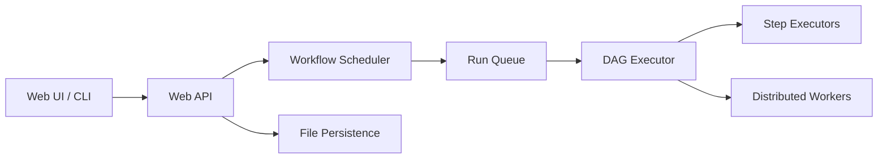

# dagucloud/dagu

> Single-binary workflow engine, defined in YAML, to automate scripts and operations tasks.

## The problem
Cron handles neither dependencies, retries nor history. Airflow or Temporal require a whole platform or rewriting your jobs in their SDK.

## What it actually does
A YAML file describes steps, dependencies, retries, scheduling (cron, time zones, catch-up) and human tasks. Each step runs a shell command, a Docker container, a Kubernetes Job, SSH, SQL, HTTP or an official action (dbt, DuckDB, ffmpeg…). State is stored in files, with no database or broker. A web UI, a REST API and a built-in MCP server are provided. Execution can be spread across workers via a gRPC coordinator.

## How it is wired


## Trying it
```bash
brew install dagu
dagu start hello.yaml
dagu start-all --dags .
docker run --rm -v ~/.dagu:/var/lib/dagu -p 8080:8080 ghcr.io/dagucloud/dagu:latest dagu start-all
```
The `hello.yaml` file contains one step `run: echo "hello from Dagu"`.

## Cost and gotchas
The community edition is free; a "self-host" license adds SSO, RBAC, audit and incident integration. Mounting the Docker socket gives workflows control of the host. The README recommends `builtin` authentication and warns of a notification routing defect in v2.11.0 to v2.11.2. `curl | bash` installers should be read first.

## What it is not
Not a data orchestrator in the Airflow sense: no native notion of assets. The embedded Go API is experimental. Scaling relies on shared files.

## Alternatives
- Airflow: preferable for an ecosystem of data operators and large volumes, at the price of a platform to operate.
- Temporal: preferable for durable execution inside application code.

## For you
Adopt it to automate ETL, dbt and scripts without standing up a platform: a binary and YAML are enough, and the paid features remain optional.
