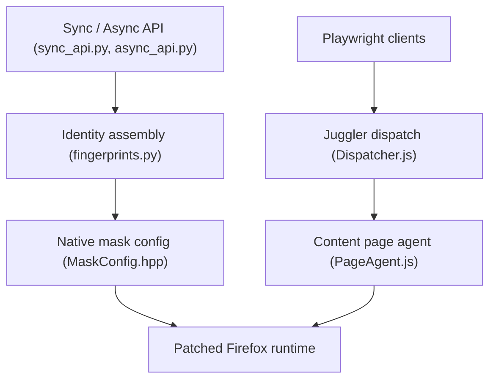

# daijro/camoufox

> Modified Firefox drivable by Playwright, presenting a consistent device identity, for scraping and AI agents.

## The problem
Automated browsers give themselves away: inconsistent `navigator` values, visible JavaScript overrides, automation code present in the page. Sites that detect bots block them.

## What it actually does
- Firefox fork where identity (navigator, screen, WebGL, fonts, audio, timezone, WebRTC) is answered in C++, not by JS injection.
- At each launch, draws a device from a real-traffic distribution (fpgen) and rejects impossible combinations.
- Isolated Juggler protocol: Playwright reads the page without leaving visible code in it.
- Options: "human" cursor replayed from 2356 recordings, geoip aligned with the proxy, uBlock by default, telemetry removed.

## How it is wired


## Trying it
```bash
pip install -U "camoufox[geoip]"
camoufox fetch
```
```python
from camoufox.sync_api import Camoufox

with Camoufox(headless=True) as browser:
    page = browser.new_page()
    page.goto("https://example.com")
```

## Cost and gotchas
Free, but the README recommends rotating residential proxies, which are paid (the page is mostly filled with provider promo codes). The README warns that the project is under development, not stable for production.

## What it is not
- Not undetectable: the README admits that anti-bot vendors may spot it.
- Only presents Firefox identities; some WAFs test the SpiderMonkey engine.
- Dual-use tool: it bypasses anti-bot defenses. Use it on sites whose data you have the right to extract, respecting their terms of use and the law.
- Mixed licenses: browser MPL-2.0, Python/TS packages MIT, cursor trajectories LGPLv3+.

## Alternatives
- Playwright with Chromium (CDP): more standard, but values are overridden on the page side, according to the README's comparison table.
- JavaScript injection: simpler, but the overrides remain visible (`toString()`).

## For you
Worth watching: useful for AI agents or legitimate scraping on sites that block automation, but a Firefox fork maintained by a single person, declared unstable, should not go into production without a plan B.
