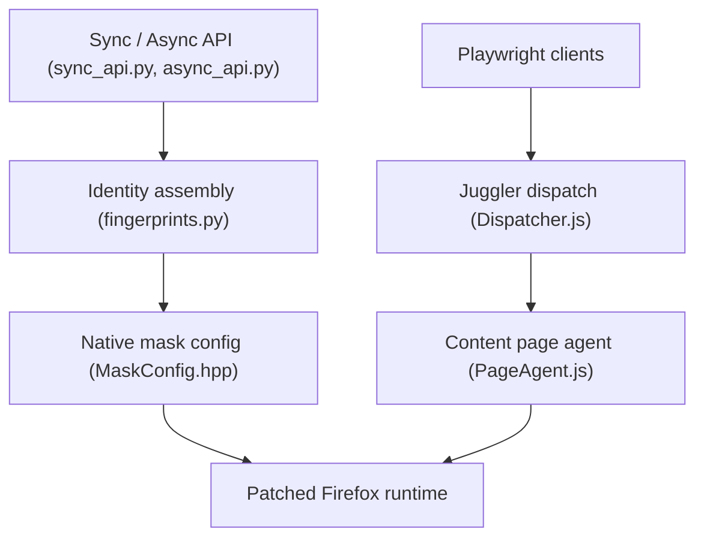

# daijro/camoufox

> Firefox modifié pilotable par Playwright, qui présente une identité d'appareil cohérente, pour le scraping et les agents IA.

## Le problème
Les navigateurs automatisés se trahissent : valeurs `navigator` incohérentes, surcharges JavaScript visibles, code d'automatisation présent dans la page. Les sites qui détectent les robots les bloquent.

## Ce que ça fait vraiment
- Fork de Firefox où l'identité (navigator, écran, WebGL, polices, audio, fuseau, WebRTC) est répondue en C++, pas par injection JS.
- À chaque lancement, tire un appareil dans une distribution de trafic réel (fpgen) et rejette les combinaisons impossibles.
- Protocole Juggler isolé : Playwright lit la page sans y laisser de code visible.
- Options : curseur « humain » rejoué depuis 2356 enregistrements, geoip aligné sur le proxy, uBlock par défaut, télémétrie retirée.

## Comment c'est branché


## Essayer
```bash
pip install -U "camoufox[geoip]"
camoufox fetch
```
```python
from camoufox.sync_api import Camoufox

with Camoufox(headless=True) as browser:
    page = browser.new_page()
    page.goto("https://example.com")
```

## Coût et pièges
Gratuit, mais le README recommande des proxys résidentiels rotatifs, payants (la page est surtout remplie de codes promo de fournisseurs). Le README avertit que le projet est en développement, pas stable pour la production.

## Ce que ce n'est pas
- Pas indétectable : le README admet que des éditeurs anti-bot peuvent le repérer.
- Ne présente que des identités Firefox ; certains WAF testent le moteur SpiderMonkey.
- Outil à double usage : il contourne des défenses anti-robots. À employer sur des sites dont on a le droit d'extraire les données, dans le respect de leurs conditions d'utilisation et de la loi.
- Licences mixtes : navigateur MPL-2.0, paquets Python/TS MIT, trajectoires du curseur LGPLv3+.

## Alternatives
- Playwright avec Chromium (CDP) : plus standard, mais les valeurs sont surchargées côté page, selon le tableau de comparaison du README.
- Injection JavaScript : plus simple, mais les surcharges restent visibles (`toString()`).

## Pour toi
Surveiller : utile pour des agents IA ou du scraping légitime sur sites qui bloquent l'automatisation, mais un fork de Firefox maintenu par une seule personne, déclaré instable, ne se met pas en production sans plan B.

