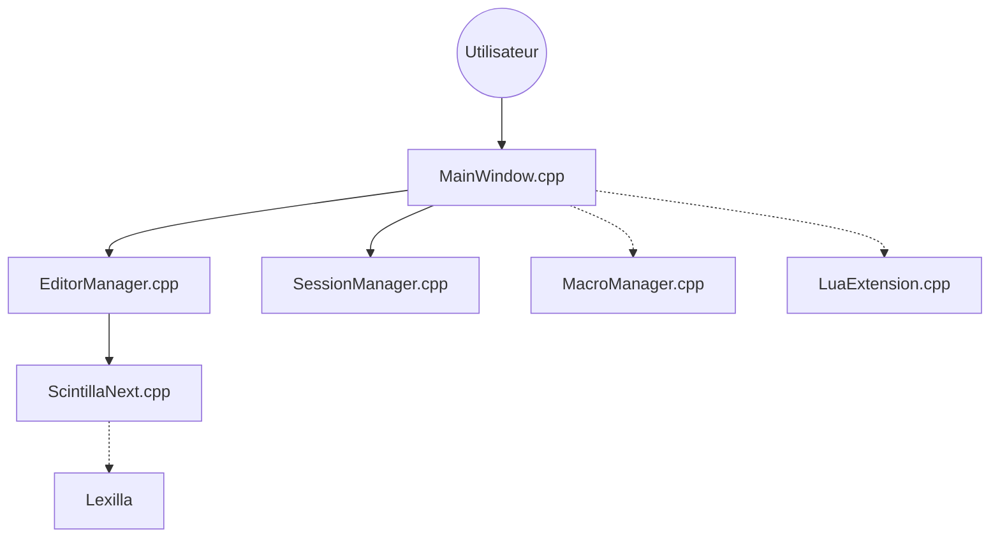

# dail8859/NotepadNext

> Cross-platform reimplementation of Notepad++ in Qt, for anyone who wants a graphical text editor outside Windows.

## The problem
Notepad++ only exists on Windows. There is no editor of the same style on Linux and macOS.

## What it actually does
Desktop editor based on Scintilla: tabs, search and replace, macros, text sorting and conversion, import of Notepad++ settings, Lua extensions, sessions and recent files. The author warns that it is stable and usable, but not to be used for critical work, with many bugs.

## How it is wired


## Trying it
```bash
winget install dail8859.NotepadNext
flatpak install flathub com.github.dail8859.NotepadNext
brew tap dail8859/notepadnext
brew install notepadnext
```

## Cost and gotchas
Free, no key or account. On macOS, the application may be flagged as "damaged": you need to remove the quarantine with `xattr`. GPL-3.0 license (copyleft).

## What it is not
Not a complete Notepad++ clone: the README mentions half-working implementations. Not a tool for data or AI code, just a text editor.

## Alternatives
- microsoft/edit: terminal editor, lighter, no graphical interface.

## For you
Ignore: a data / MLOps profile works in VS Code or in a terminal, and the author advises against this editor for critical work.
