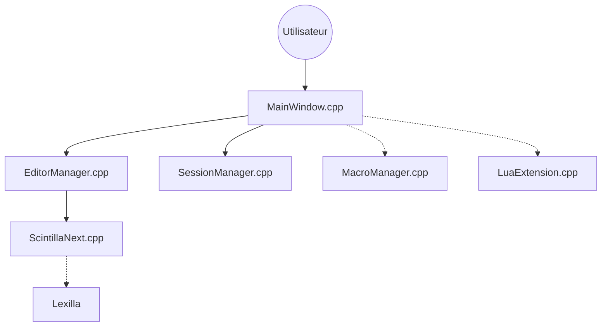

# dail8859/NotepadNext

> Réimplémentation multiplateforme de Notepad++ en Qt, pour qui veut un éditeur de texte graphique hors Windows.

## Le problème
Notepad++ n'existe que sous Windows. Il manque un éditeur du même style sur Linux et macOS.

## Ce que ça fait vraiment
Éditeur de bureau basé sur Scintilla : onglets, recherche et remplacement, macros, tri et conversion de texte, import de réglages Notepad++, extensions Lua, sessions et fichiers récents. L'auteur prévient lui-même : stable et utilisable, mais à ne pas employer pour un travail critique, avec de nombreux bogues.

## Comment c'est branché


## Essayer
```bash
winget install dail8859.NotepadNext
flatpak install flathub com.github.dail8859.NotepadNext
brew tap dail8859/notepadnext
brew install notepadnext
```

## Coût et pièges
Gratuit, sans clé ni compte. Sous macOS, l'application peut être signalée « endommagée » : il faut retirer la quarantaine avec `xattr`. Licence GPL-3.0 (copyleft).

## Ce que ce n'est pas
Pas un clone complet de Notepad++ : le README parle d'implémentations à moitié fonctionnelles. Pas un outil pour de la donnée ou du code d'IA, juste un éditeur de texte.

## Alternatives
- microsoft/edit : éditeur en terminal, plus léger, sans interface graphique.

## Pour toi
À ignorer : un profil data / MLOps travaille dans VS Code ou en terminal, et l'auteur déconseille cet éditeur pour du travail critique.

