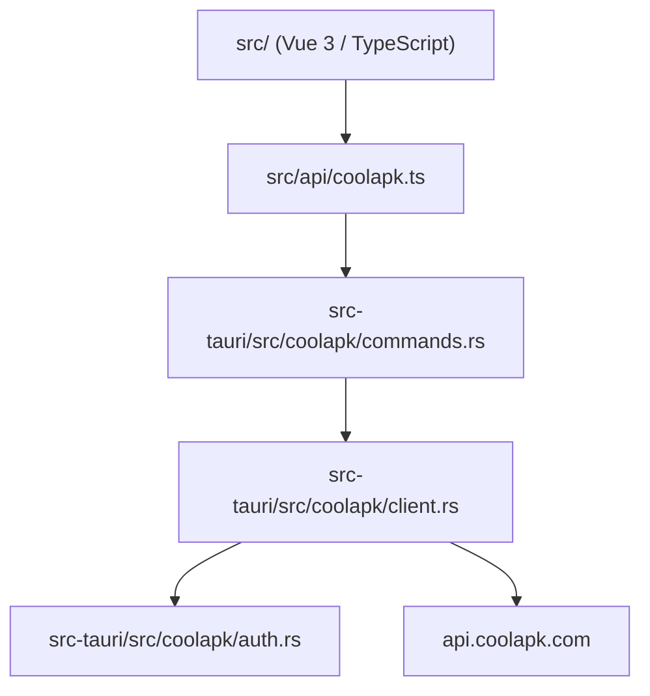

# daimiaopeng/coolapk-desktop

> Unofficial client for the Coolapk community, for Windows, macOS, Linux, Android and iOS, built on Tauri.

## The problem
The Chinese social network Coolapk has no official desktop client. This project offers one, without going through the browser.

## What it actually does
Displays the Coolapk news feed, comments, history, favorites, search and private messages. The frontend is in Vue 3 and TypeScript, the native layer in Rust/Tauri 2, which signs and sends requests to api.coolapk.com. Several accounts are handled locally. Some features may break if Coolapk changes its API.

## How it is wired
Simplified diagram based on the fiche, no diagram provided.


## Trying it
```bash
git clone https://github.com/daimiaopeng/coolapk-desktop.git
cd coolapk-desktop
npm ci
npm run tauri dev
```

## Cost and gotchas
Free. The repository is archived: no more fixes if Coolapk's API changes. Building requires Node.js 22+, stable Rust and the Tauri 2 system dependencies; ready-to-use packages are on GitHub Releases.

## What it is not
Not a Coolapk product; Coolapk has no connection to the project. The iOS IPA is not signed: you have to re-sign it yourself.

## Alternatives
No alternative named in the README.

## For you
Ignore: client for a Chinese social network, archived, unrelated to data or MLOps.
